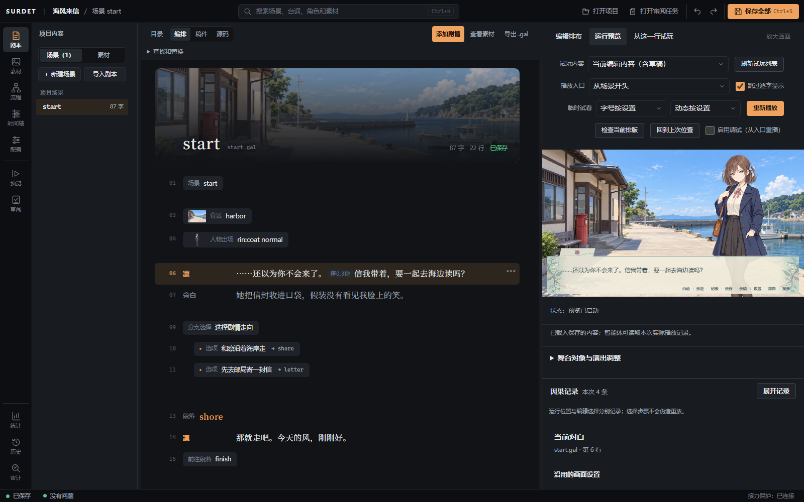
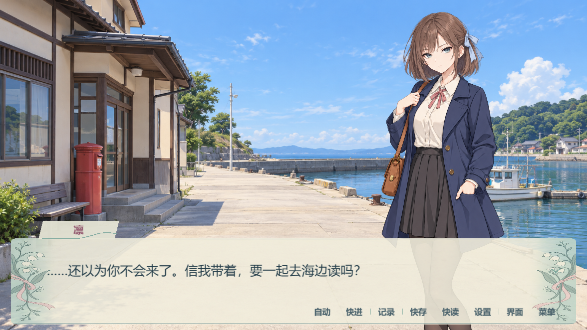
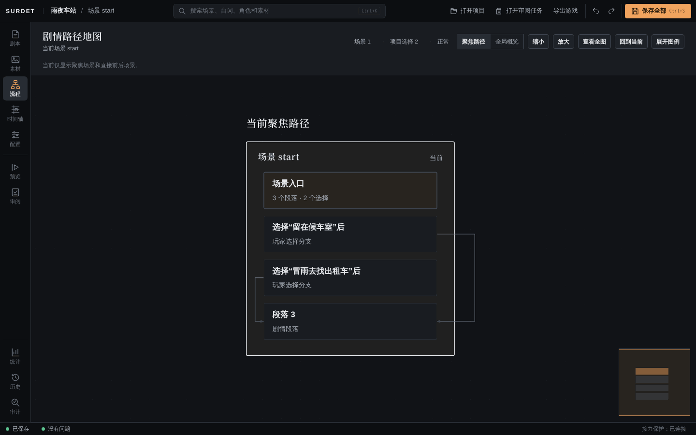
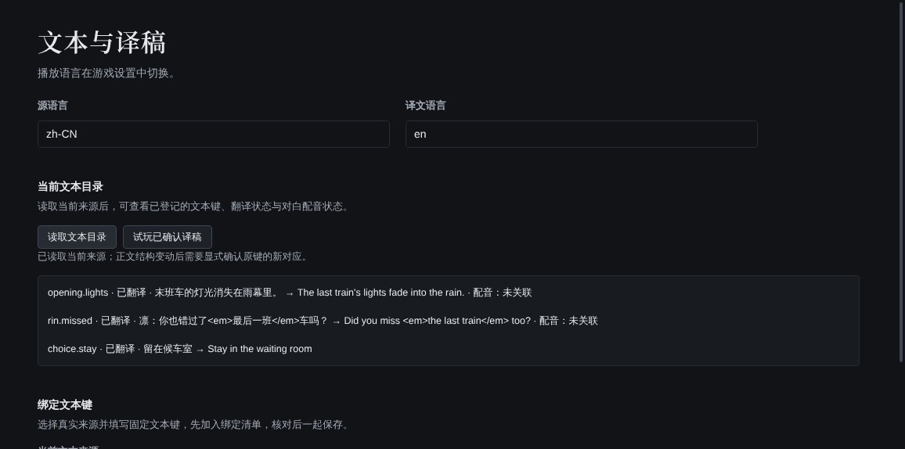

<div align="center">

# Surdet

### 把故事写出来，也把它做成能玩的世界。

面向视觉小说与 Galgame 的创作引擎，集剧本编辑、舞台演出、玩家运行时与外部 AI 创作工具于一体。

**简体中文** · [English](README.en.md)

[](LICENSE) [](packages/core) [](package.json) [](docs/guide/export-windows.md) [](docs/AI-GUIDE.md)

<table>
<tr><th>① 在编辑器里编排</th><th>② 在游戏中实际演出</th></tr>
<tr>
<td width="50%"><a href="docs/readme/editor-arrange.png"></a></td>
<td width="50%"><a href="docs/readme/player-harbor.png"></a></td>
</tr>
</table>

<sub>同一段场景，从编排到实际播放。使用已选定的素材库美术，均为真实 Editor / Player 截图；点击可看大图。</sub>

**[先看演示](#演示与创作功能) · [源码启动](#快速开始) · [跟着教程做](docs/guide/tutorial.md)**

</div>

## 三件事，始终由你掌握

- **创作方式自由选。** 可视化编排与纯文本 `.gal` 剧本并行，操作的是同一份故事。
- **项目文件归作者。** 剧本、配置和素材留在自己的文件夹里，可以用自己的工具管理、备份与版本控制。
- **AI 改动先审再用。** 外部 AI 先修改隔离草稿，你查看差异、试玩，确认后再授权写回作品。

## 快速开始

### 1. 获取并构建源码

准备 **Node.js 24 或更高版本、npm 和 Git**：

```powershell
git clone https://github.com/Equinox7379/Surdet.git
cd Surdet
npm ci
npm run build
```

根目录的构建命令按依赖顺序构建引擎、创作工具、编辑器与 Starter。首次安装会下载项目依赖；已准备好的开发环境可以继续复用。

### 2. 打开桌面 Editor

在 Windows 上运行：

```powershell
npm run desktop:build -w surdet-editor
npm run desktop -w surdet-editor
```

打开后选择新建示例项目，先体验完整的短篇；也可以新建空白项目，从第一句对白开始。

<details>
<summary>可选：生成能双击启动的 Editor 文件夹</summary>

如果希望生成可直接双击的 Editor 文件夹：

```powershell
npm run desktop:pack -w surdet-editor
```

输出位于 `packages/editor/release/editor/win-unpacked/`。保留整个文件夹，运行其中的 `Surdet Editor.exe`。使用这份已构建的程序不需要另装 Node.js。

</details>

<details>
<summary>浏览器开发入口与示例游戏</summary>

浏览器版 Editor：

```powershell
npm run dev -w surdet-editor
```

使用 Chrome 或 Edge 打开终端显示的地址，选择一个项目目录。

运行仓库示例《雾港来信》：

```powershell
npm run dev -w surdet-starter
```

这个示例包含三条结局，并附可选自由探索内容。

</details>

### 3. 做完你的第一个短篇

跟着[《雨夜车站》完整教程](docs/guide/tutorial.md)，从空白项目做一个有两条分支、一个结局的故事：

1. 新建项目，配置角色与变量。
2. 导入背景和立绘，编写对白与选择。
3. 添加注音、停顿和其他文字样式。
4. 试玩分支，使用存档、文字记录和阅读设置。
5. 检查问题、记录版本，并导出 Windows 游戏。

教程附有练习用素材；熟悉流程后，可以继续导入自己的美术与声音。

## 当前成熟度

> **可以从源码开始体验，仍在持续开发。** 当前重点是 Windows 桌面创作与 Windows 游戏导出。

- **获取方式：** 当前从源码构建；桌面程序未签名，尚未提供正式签名安装器或公共 npm 安装流程。
- **创作范围：** 已有对白、分支、舞台、自定义界面、多语言与 AI 草稿等能力；具体支持范围、升级与存档规则见[能力清单](docs/capability-matrix.md)、[已知限制](docs/known-limitations.md)及[版本与数据支持](docs/guide/versions-and-data.md)。
- **平台与语言：** 浏览器开发主要使用 Chrome / Edge；尚不承诺完整 Linux / macOS 作者发行版。本页可切换中英文，Editor 和详细作者指南目前主要为中文。
- **展示范围：** 首屏两图于 2026-10-21 在 Windows 上，从真实浏览器 Editor 与共享 Player 截取，使用选定美术和专门编写的演示场景，不代表新项目的默认外观。后文教程配图来自较早构建。[图片来源与素材授权](THIRD_PARTY_NOTICES.md#readme-showcase)。

剧情、美术、配音和最终试玩仍由作者完成；示例与自动检查帮助创作，不代替作品本身的质量判断。

## 演示与创作功能

首屏两图来自同一段港口场景：放入背景与凛的立绘，写一句对白，再接上两条选择。点击编辑器里的**运行预览**，就能在剧本旁播放真实游戏；下面的大图展示同一场景的对话皮肤与阅读控件。


| 你想做的事 | Surdet 提供的工具 |
| --- | --- |
| 把台本变成可玩的分支故事 | 编排、稿件、源码三种视图，角色、变量、条件、跳转和流程图 |
| 调整一句话的语气和节奏 | 注音、着重号、颜色、字号、停顿，以及编辑时的标签补全和错误提示 |
| 让画面配合剧情 | 人物姿态、多层场景、视差、镜头、转场、滤镜和多轨时间轴 |
| 做出属于作品自己的菜单 | 界面设计器、主题、九宫格、控件状态、页面动效及主题导入预览 |
| 给玩家完整的阅读体验 | 存读档、回退、文字记录、自动播放、快进、阅读设置与鉴赏内容 |
| 准备多语言版本 | 文本键、CSV 译稿、已有配音关联，以及保持剧情位置的作品语言切换 |
| 与 AI 助手一起制作 | CLI 与 MCP：发现能力、读取项目、修改隔离草稿、检查、试玩和授权写回 |
| 把作品交给玩家 | 从桌面 Editor 导出可运行的 Windows 游戏文件夹 |

### 写作时看得清，改动后试得快

在编排视图中，背景、人物、对白和选项都是可以编辑的剧情步骤。稿件视图适合连续阅读与润色，源码视图保留精确表达的自由。你可以从某一行开始试玩，或者沿流程图检查分支的去向。

错误提示会带你回到相关剧本位置。行内标签写错时，编辑器保留你的原文并说明问题；撤销、重做、草稿与保存仍是日常创作的一部分。

### 把分支结构放到眼前

路线越来越多时，单靠记忆很难判断故事会走到哪里。流程视图用于查看场景与选择之间的关系；剧情检查记录实际访问、条件结果和停止原因，帮助你定位缺失的连接或错误引用。



从检查结果回到对应剧本位置，修改后再走一遍这条分支。

### 让文字和演出一起工作

ADV 对话、NVL 小说模式、注音和着重号可以服务不同的叙事节奏。舞台层支持人物与环境图层分别运动；多轨时间轴可以组织一段演出，并复用有限的片段。


背景、立绘、配乐、音效、语音和视频通过项目素材引用接入。素材导入、移动与改名有对应的项目操作，不需要为了换一张图修改播放器源码。

### 界面也属于你的作品

标题、对话、选项、系统菜单、存档、设置、文字记录与鉴赏页面可以通过作品界面配置组织。设计器提供文字、背景、边框、内边距、阴影与九宫格等样式，以及悬停、焦点、按下、禁用状态和页面进出动效。

主题或界面片段导入前，会先显示受影响页面、图片与字体的变化。你可以预览、试玩，再决定是否应用。现有技术示例可以帮助你理解格式：

- [文字排版与图像皮肤](docs/ui-style-u1-example.md)
- [控件交互与页面动效](docs/ui-interaction-contract.md)
- [完整主题与导入预览](docs/ui-theme-u3-technical.md)

### 为译稿留好位置

正文、选项、人物显示名和自定义界面文字可以登记文本键，导出 CSV，填写译文后预览并确认导入。对白还可以按文本键与语言关联已有录音。



共享 Player 支持在阅读设置里切换作品语言并保持剧情进度。译文缺失时显示原文；录音缺失或过期时允许无声阅读。

## 剧本是什么样的

`.gal` 是可直接阅读的文本。下面是一段不依赖外部素材的分支示例，可放进空白项目的 `start.gal`：

```text
@scene start

雨声在候车室的屋檐下连成一片。
凛：最后一班车，已经走了。

@choice
  留下来等天亮 -> @goto stay
  去看看外面的雨 -> @goto rain

@label stay
我在长椅的另一端坐下。
凛：那就一起等吧。<w=500>天总会亮的。
@goto finish

@label rain
门外的风把雨吹进了灯光里。
凛：……伞在这里。记得还我。

@label finish
<em>雨夜还很长。</em>
@end
```

`@end` 结束当前场景；整部作品是否在此回到标题，由项目的结束场景配置决定。角色、变量、素材与更复杂的演出可以逐步加入。完整语法以 [DSL 规范](docs/dsl-spec.md)和[行内文字说明](docs/guide/inline-text.md)为准。

## 外部 Agent 创作

Surdet 的 AI 接口围绕真实项目操作设计。外部助手可以读取已有场景与素材，在隔离草稿中修改，再调用校验、模拟和运行观察来检查结果。你仍可以在 Editor 中查看差异、试玩并决定是否写回。

**不需要绑定某一家模型服务。** 引擎不内置模型，也不要求为了普通手动创作配置 AI 账号。连接哪个模型、哪些项目内容会发往该服务，取决于你选用的外部客户端及其设置。

完成前面的构建后，启动 Agent Port：

```powershell
node packages/cli/dist/agent-port/main.js --project "C:/games/my-story" --policy stage
```

支持 stdio MCP 的客户端可按以下结构配置；把两处示例路径改成自己的实际路径：

```json
{
  "mcpServers": {
    "surdet": {
      "command": "node",
      "args": [
        "C:/projects/Surdet/packages/cli/dist/agent-port/main.js",
        "--project", "C:/games/my-story",
        "--policy", "stage"
      ]
    }
  }
}
```

| 会话模式 | 用途 |
| --- | --- |
| `observe` | 读取项目；恢复的草稿可在隔离存储中追加检查证据，不写项目文件 |
| `stage` | 编写、检查和试玩隔离草稿，不写回来源项目 |
| `apply` | 由操作者明确授予项目写入权限，继续遵守事务、草稿与租约保护；组合结果还需人类批准 |

推荐顺序：**读取项目 → 建立草稿 → 编写 → 检查与试玩 → 查看差异 → 授权写回**。

需要在 Editor 中试玩同一个工作变更时：

```powershell
npm run dev:project -w surdet-editor -- --project "C:/games/my-story"
```

Editor 与 Agent Port 应绑定同一项目；使用自定义 Agent 数据目录时，两者也应一致。能力目录、素材导入、场景编辑、候选组合、恢复和实际权限边界，统一见 [AI 创作指南](docs/AI-GUIDE.md)。

## 项目文件属于作者

一个作品由可读的剧本、JSON 配置和素材文件组成：

```text
my-story/
├── game.config.json         # 标题、角色、变量、入口与玩家配置
├── package.json             # 项目身份与构建配置
├── content/
│   ├── scenario/            # .gal 剧本
│   ├── assets/              # 背景、立绘、声音、视频与字体
│   ├── timelines/           # 可选的时间轴演出
│   └── config/              # 可选的鉴赏等内容配置
└── src/                     # 项目启动入口
```

这些文件可以进入你自己的版本控制。Editor 的保存、撤销、已保存版本记录，以及 AI 工作草稿各有自己的用途；它们不会替代你对重要作品的备份。

通过 CLI 新建空白项目：

```powershell
node packages/cli/dist/index.js new my-story --directory "C:/games/my-story" --template blank
```

普通作品使用共享 Player，无须复制一套菜单与存档代码。独立源码项目的依赖准备方式见生成项目内的 README。

## 工作区

Surdet 用 TypeScript 构建，采用 npm workspaces。核心运行语义、创作操作和表现层分开组织，Editor 与 CLI 共享 Authoring 层。

| 目录 | 职责 |
| --- | --- |
| [`packages/core`](packages/core) | DSL、解释器、变量、系统状态与快照语义 |
| [`packages/authoring`](packages/authoring) | 项目读取、类型化修改、校验、模拟与提交事务 |
| [`packages/cli`](packages/cli) | 命令行、Node 文件系统接入与 MCP Agent Port |
| [`packages/renderer`](packages/renderer) | PixiJS 表现、舞台、文字、音频与作品界面 |
| [`packages/host`](packages/host) | 输入、菜单、玩家操作与宿主协调 |
| [`packages/shell`](packages/shell) | Electron 壳、桌面存储与游戏打包 |
| [`packages/editor`](packages/editor) | 可视化创作与桌面 Editor |
| [`examples/shared`](examples/shared) | `@surdet/player` 共享播放器 |
| [`examples/starter`](examples/starter) | 《雾港来信》示例 |
| [`examples/zero-after-midnight`](examples/zero-after-midnight) | 《零点之后》独立玩家入口示例 |
| [`games/tide-mark`](games/tide-mark) | Tide Mark 游戏工作区 |

进一步了解模块关系，请看[架构说明](docs/architecture.md)。

## 文档入口

| 想了解什么 | 从这里开始 |
| --- | --- |
| 不读源码，先把作品做出来 | [中文作者指南](docs/guide/README.md) · [完整教程](docs/guide/tutorial.md) |
| 剧本的精确写法 | [DSL 规范](docs/dsl-spec.md) · [行内标签](docs/guide/inline-text.md) |
| 素材与舞台演出 | [作者指南](docs/guide/assets-and-staging.md) · [舞台与特效说明](docs/presentation-effects-contract.md) |
| 自定义界面和主题共享 | [样式](docs/ui-style-contract.md) · [交互](docs/ui-interaction-contract.md) · [导入预览](docs/ui-sharing-import-contract.md) |
| 译稿与配音关联 | [文本与译稿](docs/guide/translation.md) |
| 导出自己的 Windows 游戏 | [作者步骤](docs/guide/export-windows.md) · [导出支持范围](docs/windows-game-export-contract.md) |
| 给外部 AI 助手接入工具 | [AI 创作指南](docs/AI-GUIDE.md) |
| 哪些能力已有、哪些尚未完成 | [能力矩阵](docs/capability-matrix.md) · [当前限制](docs/known-limitations.md) |
| 升级与改稿会怎样影响数据 | [版本与数据支持](docs/guide/versions-and-data.md) |

全部文档见[文档索引](docs/README.md)，欢迎补充教程与翻译。

## 参与开发

欢迎带着一个具体的故事、问题或改进来试用 Surdet。作者的真实操作反馈，往往比抽象的功能清单更有价值。

- **报告问题：** 在 [Issues](https://github.com/Equinox7379/Surdet/issues) 写清步骤、预期与实际结果、版本和运行平台。附最小示例或截图时，请先移除凭据、个人路径和未公开剧本。
- **提交改进：** 使用独立分支和 Pull Request，说明问题、改动后的行为、相关验证及未覆盖范围。
- **完善文档：** 教程勘误、英文翻译和更清楚的示例都很有帮助。
- **制作主题或示例：** 欢迎展示自己的作品；提供素材时请同时说明来源和使用许可。

### 验证

开发修改应选择受影响部分的测试。已完成工作区构建后，例如：

```powershell
npm run test -w @surdet/core -- test/inline-text.test.ts
npm run typecheck -w surdet-editor
npm run verify:docs
```

具体测试路径请以所改模块为准；`verify:docs` 检查现有能力矩阵的一致性，并非所有文档和链接的通用校验器。仓库还提供 `verify:all` 供允许完整验证的环境使用。遵守当前任务与 [AGENTS.md](AGENTS.md) 的执行约定，测试结果应说明实际覆盖范围。

## 许可证

Surdet 自有引擎源码和技术文档采用 [MIT License](LICENSE)。你可以在遵守许可的前提下使用、修改和分发引擎，包括用于商业作品；使用 Surdet 不要求你把自己的游戏源码或剧本开源。

**引擎许可不等于素材许可。** 示例剧情、美术、音乐、视频、字体、作品标识及第三方组件按各自声明处理。没有明确授权的作品素材，不应当作免费素材包再分发。具体范围见 [THIRD_PARTY_NOTICES.md](THIRD_PARTY_NOTICES.md)。

---

<div align="center">

**从第一句对白开始。**

[阅读教程](docs/guide/tutorial.md) · [浏览源码](packages) · [反馈问题](https://github.com/Equinox7379/Surdet/issues) · [English](README.en.md)

</div>
