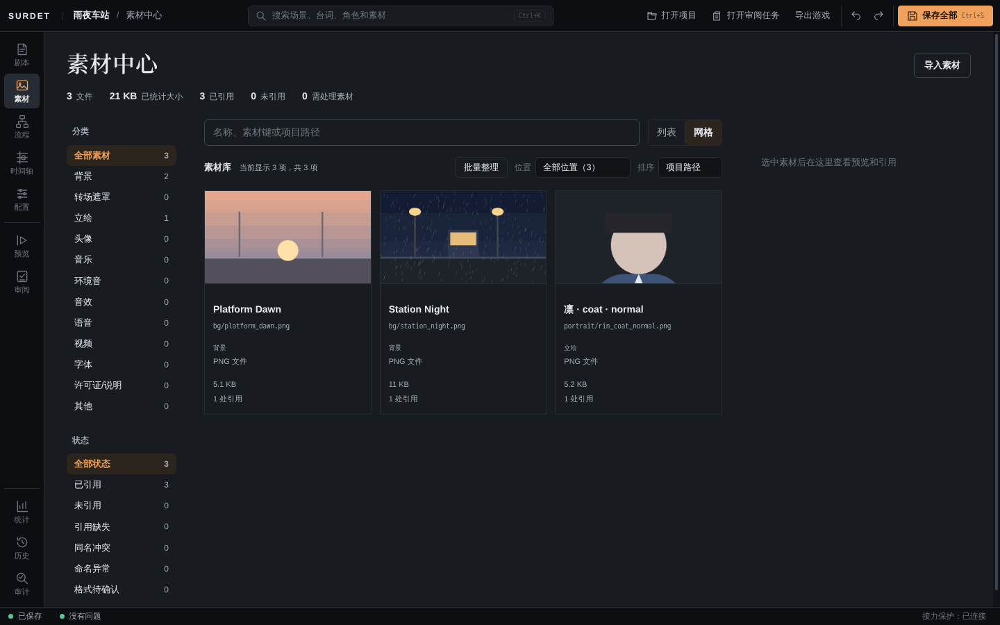
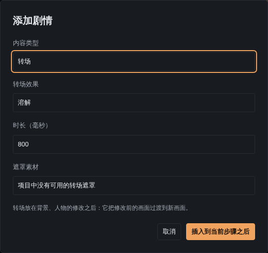
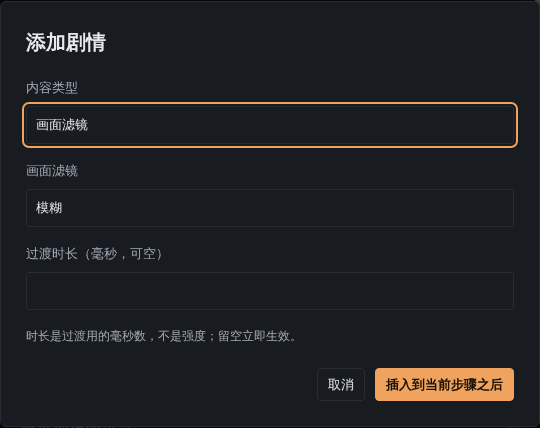

# 素材与演出

## 导入素材

素材放在项目的 `content/assets/` 里，按分类分到不同子文件夹。不要直接往文件夹里拷文件，用素材中心导入：它会检查格式和名称，导入错了也能撤销。

1. 点左侧「素材」，再点右上角「导入素材」。
2. 点「选择文件，或拖到这里」，可以一次选多个文件。在「导入」确认之前，文件不会写进项目。
3. 在「文件设置」里给每个文件选「素材分类」，确认「最终名称」。下方的「目标位置」会显示文件将放到哪里。
4. 右侧「预览与问题」显示选中文件的预览和需要处理的问题。
5. 点「准备导入」，再点「确认导入」。

导入完成后：

- 「查看已导入素材」跳到素材库；
- 「撤销本次导入」会把这次导入的文件移出素材库，并保留恢复副本；导入后又被修改过的文件不会被撤销。
- 状态栏会提示「外部变更已写入项目」，点「同步项目」后再继续编辑。

### 分类和命名

可选的分类有：背景、转场遮罩、立绘、头像、音乐、环境音、音效、语音、视频、字体、许可证/说明、其他。

**立绘**按 `角色标识_服装_表情` 命名，例如 `rin_coat_normal.png`：角色 `rin`、服装 `coat`、表情 `normal`。同一个角色的不同表情用同一个前缀，例如 `rin_coat_smile.png`。添加「人物」步骤时，Editor 会按这个规则列出「凛 · coat」和它的表情。角色标识要和「配置 → 角色」里的一致。

常用格式：图片 PNG、JPEG、WebP；声音 WAV、OGG、MP3；视频 MP4、WebM；字体 TTF、OTF、WOFF2。使用字体时，请把字体的许可证一起导入（分类选「许可证/说明」），导出游戏时会检查。

## 素材中心

- 左侧按**分类**和**状态**筛选。状态有：已引用、未引用、引用缺失、同名冲突、命名异常、格式待确认。
- 「列表」「网格」切换显示方式。
- 选中一个素材，右侧会显示预览和它在剧本里被引用的位置。
- 移动、改名或原位替换素材时，Editor 会先列出受影响的引用，确认后才执行。

## 背景和人物

在剧本的「编排」视图里用「添加剧情」：

- **背景**：选一张背景素材。
- **人物**：选「角色 · 服装」和表情。插入后，右侧检查器可以改「出场位置」（左侧、中央、右侧）；展开「全部参数与高级语法」可以设置坐标、缩放、朝向等，写法见 [DSL 规范：演出](../dsl-spec.md#演出)。

## 转场与画面滤镜

**转场**把修改前的画面过渡到新画面，所以要放在背景、人物的修改**之后**。可选效果有：淡入淡出、向左滑动、向右滑动、圆形展开、溶解，以及遮罩（需要先导入「转场遮罩」类素材）。「时长」以毫秒计。

**画面滤镜**有模糊、灰度、怀旧、暗角，「清除」用来去掉滤镜。「过渡时长」是滤镜从无到有用的毫秒数，不是强度；留空则立即生效。

试玩时，玩家打开「减少动态效果」后，转场和淡入淡出会直接完成，不再播放动画。

## 声音

导入音乐、环境音、音效或语音后，用「添加剧情」里的「音乐」「音效」「语音」插入。对白检查器里的「关联语音」可以把一段语音和这句台词关联起来。

## 时间轴演出

需要多个对象一起动的演出（例如人物移动、镜头推拉、背景和声音配合），可以在左侧「时间轴」里新建演出片段，按轨道安排，再在剧本里用「添加剧情」→「时间轴」播放。

## 作品外观

在「配置」里：

- **主题外观**：标题字标和背景、对话框和按钮皮肤、字体、各种界面颜色、字号与间距等。直接填中文表单即可，留空恢复默认；修改先进入草稿，可撤销，保存后生效。
- **界面设计**：自定义标题、系统菜单、存读档、设置、鉴赏、历史（文字记录）、对白、选项等页面的布局。「试玩草稿」可以带着未保存的界面直接试玩。

用界面设计自定义「历史」（文字记录）页时，默认列表行里的台词会显示作品里写的静态样式（粗体、斜体、颜色、字号、着重号、注音），不会重放停顿和动画。自己制作行模板并绑定 `label` 的地方仍显示纯文字；默认文字记录页也保留原有样式显示。
