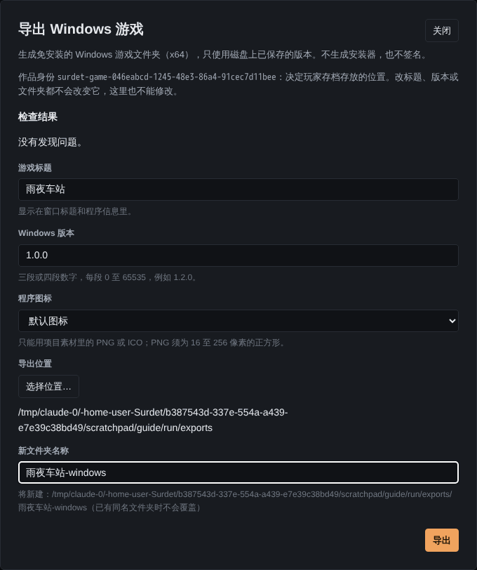

# 导出 Windows 游戏

点右上角「导出游戏」，可以把作品导出成一个免安装的 Windows 游戏文件夹（x64）。玩家拿到整个文件夹后，双击其中的程序就能玩，不需要安装 Surdet 或其他软件。

> **Windows 核对情况：** 本页截图来自 Linux 环境，那里不能生成 Windows 程序。技术负责人在 Windows 上用当前日常打包的 Editor 核对过：用[完整教程](tutorial.md)末尾的剧本、三张占位图和教程里的角色、变量，通过导出对话框导出了「雨夜车站.exe」，实际运行到开场，背景正常显示，游戏数据放在独立目录。导出位置由受控的替身提供，真人操作 Windows 系统文件夹选择框还没有核对。下文「导出结果」中的其余细节按[导出合同](../windows-game-export-contract.md)写成。

当前版本**不生成安装器，也不签名**，也不负责发布到任何平台。

## 导出前

- **先保存。** 导出只使用磁盘上已保存的版本。有未保存的修改时，对话框会提示「有尚未保存的修改」，点「保存全部并继续」。
- **看检查结果。** 对话框打开时会检查项目。有错误时不能导出，按提示修改、保存后再来；提示不阻止导出，但请确认。会阻止导出的情况包括：剧本有错误、引用了不存在的素材、用到的素材重名或格式不支持、用了字体却没有附带字体许可证。
- **素材要在 `content/assets/` 里。** 通过素材中心导入的素材都在这里。
- 改过 `src/main.ts` 等启动代码的项目不能直接导出，要先改成项目插件。用空白或示例模板创建、没改过这些文件的项目不受影响。

## 填写导出选项

| 选项 | 说明 |
| --- | --- |
| 作品身份 | 显示在对话框顶部，决定玩家存档放在哪里。改标题、版本或文件夹都不会改变它，这里也不能改 |
| 游戏标题 | 显示在窗口标题和程序信息里，默认是作品标题 |
| Windows 版本 | 三段或四段数字，每段 0 到 65535，例如 `1.2.0`。默认取 `package.json` 里的 `version` |
| 程序图标 | 只能用项目素材里的 PNG 或 ICO；PNG 必须是 16 到 256 像素的正方形。不选就用默认图标 |
| 导出位置 | 点「选择位置…」选一个父文件夹 |
| 新文件夹名称 | 在导出位置下新建的文件夹名。已有同名文件夹时不会覆盖，换个名字即可 |

**项目插件。** 作品带项目插件时，对话框会列出「项目插件（N）」，每个插件都要单独勾选「允许把插件 … 打包进游戏」。插件代码会随游戏发给玩家，在玩家电脑上运行；作品配置里写了声明不等于同意。导出时只检查和转换插件代码，不执行它。这里的确认只用于这一次导出，和试玩页的确认互不相通。

## 导出过程

点「导出」后，「导出进度」按阶段显示：检查项目、复制游戏运行时、整理剧本与配置、打包素材、核对成品、完成。进度只表示做到哪一步，不代表剩余时间。

- 导出过程中可以点「取消导出」，Editor 会等当前文件操作和清理结束后才停下。
- 导出时不能关闭窗口，也不能同时做保存、审阅等操作。
- 失败时会显示原因，导出位置和填写的内容会保留，修改后可以重试；已有的文件夹不会被删除。

## 导出结果

成功后显示「已导出『游戏标题』版本号」，可以点「在文件夹中显示」打开生成的文件夹，或「再导出一份」。

- 结果是一个文件夹，里面有游戏程序和它需要的文件。把**整个文件夹**交给玩家，不要只拷程序文件。
- 素材默认加密打包，只防随手提取，不保证无法破解。
- 文件夹里附带作品字体的许可证，以及运行库的许可文件。

### 存档放在哪里

导出的游戏按作品身份（`package.json` 里的 `name`）把存档、设置和窗口状态放在玩家电脑的独立目录里（`应用数据/Surdet Games/作品身份`）。所以：

- 不同作品的存档互不影响；
- 同一作品改了标题、版本或换了文件夹再导出，玩家的旧存档仍然能找到；
- 不要手动修改 `package.json` 的 `name`，否则玩家的存档会对不上。

旧存档能不能在新版本里继续读，见[版本与数据支持](versions-and-data.md)。

## 命令行导出

维护者也可以用命令行导出，选项和 Editor 相同。见 [Windows 导出合同](../windows-game-export-contract.md#构建与cli)。
