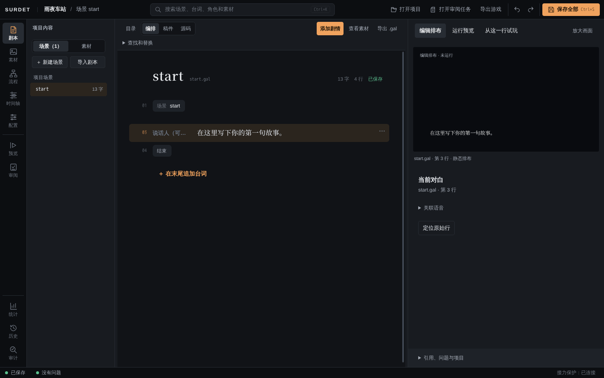

# 开始使用

## 打开 Editor

Surdet Editor 是一个免安装的 Windows 程序文件夹。保留整个文件夹，双击其中的 `Surdet Editor.exe`。不需要另装 Node、启动服务或打开浏览器。

> 这一节的 Windows 步骤由技术负责人在 Windows 上核对。当前版本未签名，也不是正式安装包。

打开后是启动页：


- **新建项目**：从示例或空白模板创建一个新作品，见下文。
- **打开项目文件夹**：选择一个包含 `game.config.json` 的文件夹。
- **打开审阅任务**：比较外部 AI 助手交付的候选修改，普通创作用不到。
- **最近项目**：打开过的项目会列在这里。

每个项目在自己的窗口里打开。再次打开同一个项目，会回到已有的窗口，不会开两份。关闭 Editor 后再启动，会重新打开上次的项目。

## 新建项目

在启动页点「新建项目」：

| 字段 | 说明 |
| --- | --- |
| 项目名称 | 作品标题，也是新文件夹的名称。可以用中文、日文和空格，最长 120 个字符，不能用 Windows 文件名不允许的字符 |
| 从哪里开始 | 「示例项目」是港口开场的可玩短篇《第一封信》，带分支、存读档和设置；「空白项目」只有基础配置和一个起始场景 |
| 保存位置 | 选一个父文件夹，项目会建在其中的新子文件夹里。已有同名文件夹时不会覆盖 |

点「创建并打开」，项目会在新窗口中打开。第一次使用可以先建一个示例项目看看完整作品的样子，再用空白项目做自己的作品。

建议先在专门的练习文件夹里试，不要第一次就拿唯一的正式作品操作。

## 界面分区



- **顶栏**：搜索框（`Ctrl+K`）、「打开项目」、「打开审阅任务」、「导出游戏」、撤销/重做，以及「保存全部」（`Ctrl+S`）。
- **左侧活动栏**分三组：
  - 创作：剧本、素材、流程、时间轴、配置；
  - 检查：预览、审阅；
  - 项目：统计、历史、审计。
- **中间**是当前工作区。在「剧本」里，左边是场景列表，中间是剧情步骤，右边是画面预览和检查器（当前选中步骤的属性）。
- **底部状态栏**：左边是保存状态和问题数，右边是「接力保护」状态。

## 保存与撤销

- `Ctrl+S` 或右上角「保存全部」会保存所有修改，包括剧本、时间轴和配置表。角色表、变量表等配置页也有各自的保存按钮。
- 有未保存修改时，状态栏显示「有未保存修改」，场景列表里对应场景标有「未保存」。
- `Ctrl+Z` 撤销，`Ctrl+Y` 重做。
- 关闭有未保存修改的窗口时会询问；正在保存或恢复时不能强行关闭。
- 剧本和时间轴的草稿有自动备份。重新启动 Editor 时会打开上次的项目，并按自动备份恢复机制处理这些草稿。不是所有配置草稿都有自动备份，改完配置请及时保存。
- 想保留一个可以回看的版本，用「历史」里的「记录已保存版本」，见[试玩与检查](preview-and-checks.md#记录版本)。

## 接力保护

状态栏右下角的「接力保护」用来防止项目文件在 Editor 之外被改动时，覆盖你还没保存的草稿。外部改动可能来自 AI 助手、其他程序，也包括在素材中心导入素材。

| 提示 | 意思 | 怎么做 |
| --- | --- | --- |
| 接力保护：已连接 | 一切正常 | 不用处理 |
| 外部变更已写入项目 | 磁盘上的项目被改过，你没有未保存的草稿 | 点「同步项目」读取最新内容；想先看改了什么，点「查看范围」 |
| 项目磁盘已变化，未覆盖你的草稿 | 磁盘被改过，而你有未保存的草稿 | 点「查看变化」确认；要继续用自己的草稿点「保留草稿」，要改用磁盘上的版本点「放弃草稿并同步」 |

导入素材后通常会看到「外部变更已写入项目」，点「同步项目」即可。

## 项目文件夹里有什么

用空白模板创建的项目大致是：

```
雨夜车站/
  game.config.json        作品配置：标题、版本、入口场景、角色、变量、译稿等
  package.json            作品身份（name 决定存档位置，不要改）
  content/
    scenario/start.gal    剧本，一个文件是一个场景，场景名就是文件名
    assets/               素材：bg/ 放背景，portrait/ 放立绘，其他分类见导入时显示的「目标位置」
  README.md               项目说明
  AGENTS.md               给外部 AI 助手的说明
  .mcp.json.example       外部 AI 助手的连接示例（不会自动启用）
  src/、index.html 等     网页版构建用的文件，普通创作不需要改
```

- `game.config.json` 里的大部分内容可以在「配置」里改，不用手动编辑。
- `package.json` 里的 `name` 是作品的稳定身份，决定玩家存档放在哪里。改标题、版本或文件夹都不会改变它，也不要手动改它。
- 剧本文件可以用任何文本编辑器打开，但最好在 Editor 里改：Editor 会检查错误，也能撤销。

## 常用快捷键

| 按键 | 作用 |
| --- | --- |
| `Ctrl+K` | 搜索场景、台词、角色和素材；输入 `>` 可以执行命令。按一次 Esc 清空，再按一次关闭 |
| `Ctrl+S` | 保存全部 |
| `Ctrl+Z` / `Ctrl+Y` | 撤销 / 重做 |
| `F8` / `Shift+F8` | 跳到下一个 / 上一个问题 |

试玩时的玩家快捷键见[存读档与阅读设置](player-features.md#玩家快捷键)。
