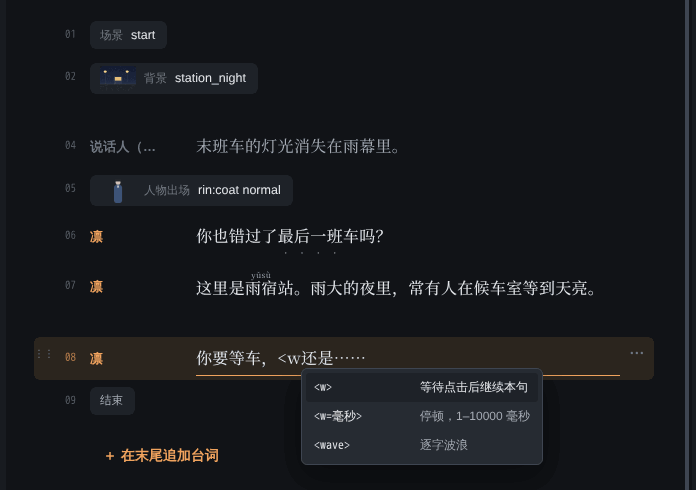
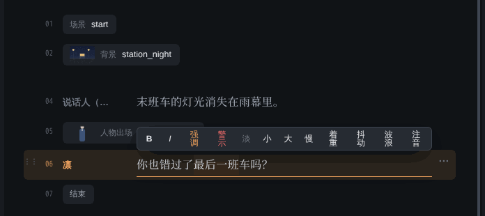
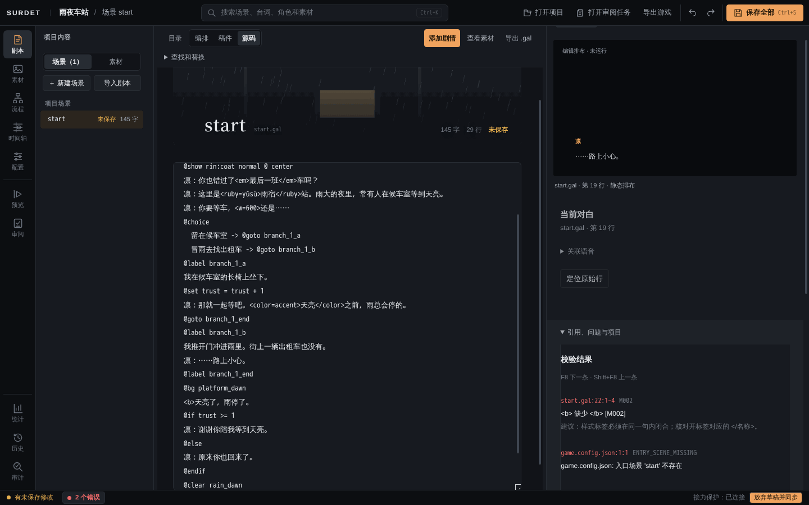
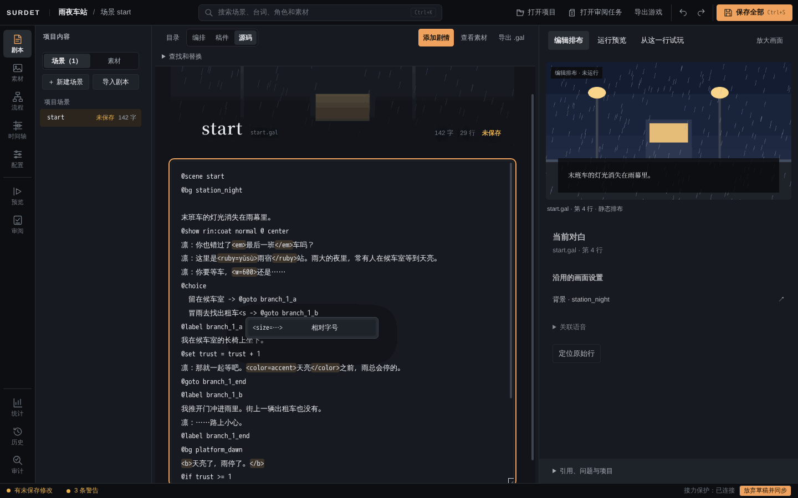
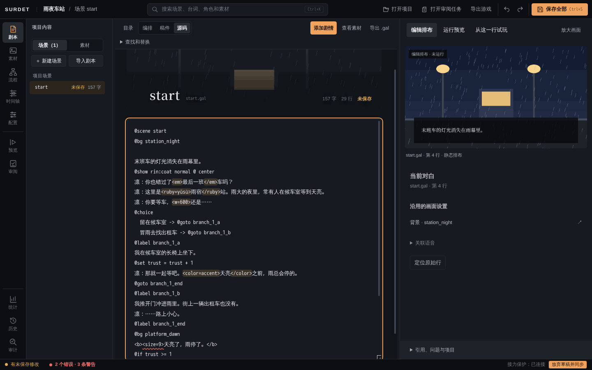
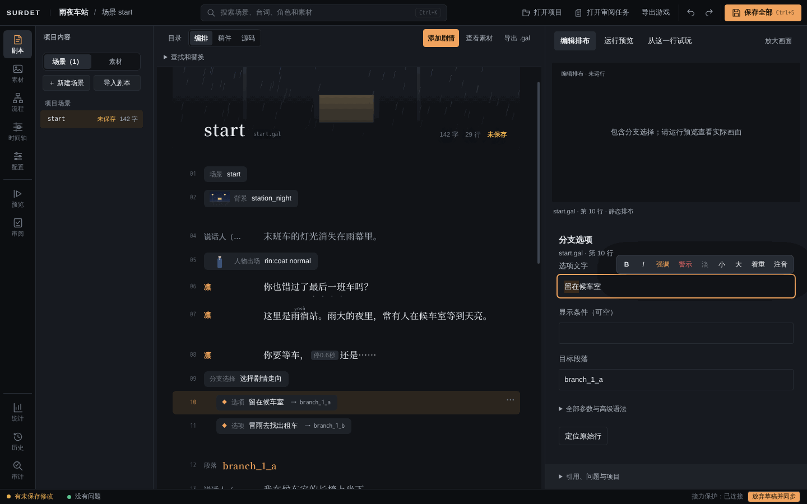

# 行内标签

行内标签写在台词里，让一句话中的部分文字带样式或节奏，例如：

```
凛：你也错过了<em>最后一班</em>车吗？
凛：这里是<ruby=yǔsù>雨宿</ruby>站。
凛：你要等车，<w=600>还是……
```

标签不是 HTML，只认下面这些。精确规则（嵌套、取值范围、快进和自动阅读时的行为）以[行内文字合同](../inline-text-contract.md)为准。

| 标签 | 作用 |
| --- | --- |
| `<b>…</b>`、`<i>…</i>` | 粗体、斜体 |
| `<color=accent>…</color>` | 颜色。可用主题色名 `text`、`textMuted`、`accent`、`accentSoft`、`danger`，或 `#RGB`、`#RRGGBB` |
| `<size=1.3>…</size>` | 字号倍数，0.5 到 2 |
| `<em>…</em>` | 着重号 |
| `<ruby=读音>字</ruby>` | 注音 |
| `<speed=0.5>…</speed>` | 打字速度倍数，0.1 到 10 |
| `<w=500>`、`<w>` | 停顿若干毫秒（1 到 10000）；不带数字时等玩家点击后继续这一句 |
| `<shake>…</shake>`、`<wave>…</wave>` | 逐字抖动、逐字波浪 |
| `<nw>` | 这句打完后自动进入下一句，只能放在句末 |

在文字记录和 NVL 里，样式（粗体、颜色、着重号、注音等）会保留，停顿、变速、自动继续和抖动波浪不会重放。

## 用补全输入

在对白框里输入 `<`，会弹出当前位置能用的标签列表，每项后面有说明。继续输入可以缩小范围，用 ↑↓ 选择，回车插入。成对的标签会一起插入，需要填值的会选中默认值，直接输入就能改。



## 用工具栏包裹选中的文字

在对白框里选中一段文字，上方会出现工具栏：

- B（粗体，`Ctrl+B`）、I（斜体，`Ctrl+I`）
- 强调、警示、淡：三种主题颜色
- 小、大：字号 0.8 倍、1.3 倍
- 慢：打字速度 0.5 倍
- 着重：着重号
- 抖动、波浪
- 注音：点了以后在小输入框里填读音，按回车



选区不能跨过已有标签的边界。比如一半在 `<b>…</b>` 里面、一半在外面，就不能再包一层，状态栏会说明原因。

## 阅读效果和源码

对白框没有焦点时，带标签的台词显示成阅读效果：着重号、注音、颜色，停顿显示为「停0.6秒」这样的小标记。点进去以后显示源码，标签会高亮。

台词的字数统计按玩家看到的文字计算，不算标签。

## 注音的写法

注音只认显式写法 `<ruby=读音>字</ruby>`：

- 读音里不能有空格。拼音可以连写，例如 `<ruby=yǔsù>雨宿</ruby>`。
- 被注音的字要在同一行，里面不能再嵌套标签。要加样式就把样式写在外面：`<em><ruby=あめ>雨</ruby></em>`。
- 不兼容旧的 `世界《せかい》` 写法。书名号《》现在就是普通书名号，原样显示。

## 选项、说话人和指令

- **选项文字**可以用粗体、斜体、颜色、字号、着重号和注音，不能用停顿、变速、自动继续、抖动和波浪。
- **说话人**和**指令参数**（例如 `@bg` 后面的素材名）不解析标签，写进去会原样显示或报错。
- 想在台词里显示真正的尖括号，写 `\<`；想显示反斜杠，写 `\\`。像 `>_<`、`a < b` 这样不像标签的写法会原样显示。

## 写错了怎么办

Editor 会立刻检查标签。有问题时：

- 对白框里出问题的位置有波浪下划线；
- 左下角状态栏显示错误或警告的数量，点它可以展开问题列表；
- 问题列表里写着行号、错误码和修改建议。按 `F8` 跳到下一个问题，并选中出错的那段标签，`Shift+F8` 回到上一个。



| 错误码 | 常见原因 |
| --- | --- |
| M001（警告） | 不认识的标签名，会按原文显示 |
| M002 | 开了标签没有关，例如 `<b>` 缺少 `</b>` |
| M003 | 关闭标签对不上，或顺序交叉 |
| M004 | 取值不对，例如 `<size=9>`、`<color=红>`，或缺少 `>` |
| M005 | 这个位置不能用这个标签，例如选项里写了 `<w>` |
| M006 | `<nw>` 不在句末 |

修改以后，旧的问题位置会失效，`F8` 会提示「内容已修改，请等待重新校验后再定位」，稍等片刻再按即可。Editor 不会自动改你的标签，怎么改由你决定。

> 有标签错误时，问题列表里可能还会多一条「入口场景 'start' 不存在」（ENTRY_SCENE_MISSING）。这是同一处错误的连带结果，改好标签后会一起消失。

## 源码视图和选项文字框（待合入）

> **待合入（PR #36）：** 以下功能已验收，尚未合入主线，当前日常使用的 Editor 还没有。

**源码视图。** 对白和选项文字里的标签会高亮，出问题的地方有波浪下划线。文本框下方有一行状态，显示光标所在行的问题，并列出其他有问题的行号。输入 `<` 同样会弹出补全：在对白里列对白可用的标签，在选项里只列选项可用的，在指令、注释、条件和跳转里不弹出。





**选项文字框。** 在编排视图里点一个选项，右侧检查器的「选项文字」变成和对白框一样的输入框：有补全、选中工具栏（只有选项可用的按钮）和问题提示，没有焦点时显示阅读效果。


