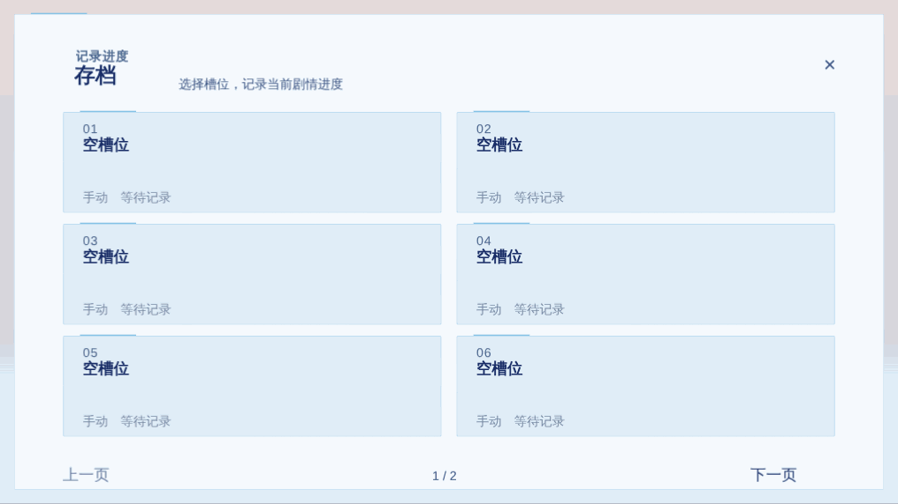
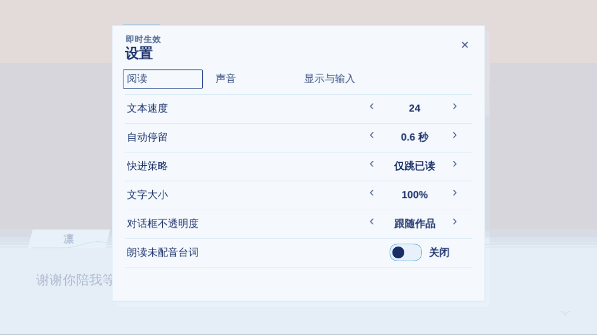
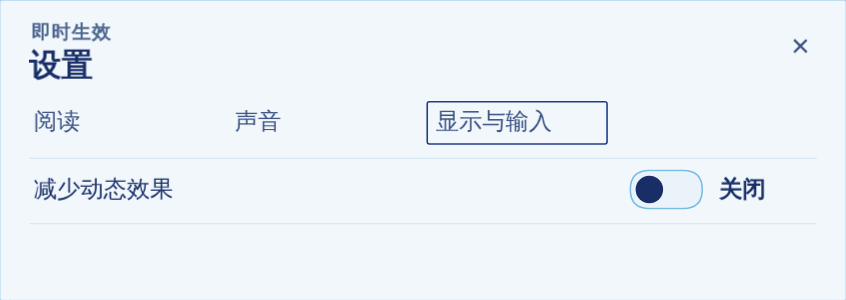

# 存读档与阅读设置

这些是玩家在游戏里能用的功能，由共享的 Player 提供，作品不用另做。在 Editor 的预览和试玩里也能直接使用。

## 玩家快捷键

| 按键 | 作用 |
| --- | --- |
| 点击、空格、回车 | 推进；选择时确认选项 |
| ↑ / ↓ | 选择时切换选项；平时按 ↑ 回退到上一句 |
| Esc | 打开菜单；在文字记录、设置等界面里返回 |
| F5 / F9 | 快速存档 / 快速读档 |
| A | 自动播放开关 |
| S | 快进（按设置里的「快进策略」） |
| X | 全部快进 |
| L | 文字记录 |
| H | 隐藏对话框 |
| G | 鉴赏 |
| `[` / `]` | 减慢 / 加快文字速度 |
| PageUp / PageDown | 在文字记录里翻页 |
| Ctrl+F | 在文字记录里搜索 |

对话框下方有一排按钮。在 Editor「预览」里是：自动、快进、记录、快存、快读、设置、界面、菜单；从标题开始的完整试玩里是：回看、自动、快进、存档、设置。

## 存档和读档

- 打开菜单（Esc 或「菜单」按钮），选「存档」或「读档」，可以选择任意槽位，槽位分多页。
- 「快存」「快读」（F5、F9）使用快速存档位。
- 读档会回到存档那一句的开头重新播放。

菜单里还有：返回游戏、设置、文字记录、自动播放、快进、全部快进、隐藏界面。

导出的游戏把存档放在该作品自己的数据目录里，不同作品互不影响，见[导出 Windows 游戏](export-windows.md#存档放在哪里)。

## 文字记录

点「记录」（或按 L）打开文字记录，可以看到读过的台词。

- 着重号、注音、粗体、颜色等样式会保留；停顿、变速、自动继续和抖动波浪不会重放。
- 带语音的台词前面有 ▶，点击可以重听。
- 文字记录会随存档保存，最多 200 条，默认显示最近 120 条。读档后看到的是那份存档里的记录。
- 选项和横幅不记入文字记录。

## 设置

点「设置」打开设置面板，设置会马上生效。设置属于这台设备上的玩家，不写进作品，也不随存档保存。

**阅读：**

| 项目 | 说明 |
| --- | --- |
| 文本速度 | 逐字显示的速度 |
| 自动停留 | 自动播放时每句停多久 |
| 快进策略 | 「仅跳已读」遇到没读过的台词就停；也可以选全部跳过 |
| 文字大小 | 80% 到 140%，放大对白、文字记录和选项的正文；菜单和名字栏不放大 |
| 对话框不透明度 | 默认「跟随作品」，也可以调得更透明或更不透明 |
| 朗读未配音台词 | 用电脑本地的系统语音朗读没有配音的台词，不联网 |

作品有已确认的译稿时，阅读页会多出第 2 页，里面是「作品语言」，见[文本与译稿](translation.md#在游戏里切换语言)。

**声音：** 各类声音的音量。

**显示与输入：** 「减少动态效果」打开后，转场、淡入淡出、画面震动、抖动和波浪等会直接完成或静止，适合对动画敏感的玩家。

在 Editor「预览」顶部的「临时试看」里也可以临时换字号和动态效果，用来检查排版，这不会改变玩家设置。

> 朗读功能使用电脑本地的系统语音，效果取决于玩家电脑上安装的语音；自动化测试不能代替人耳判断。
