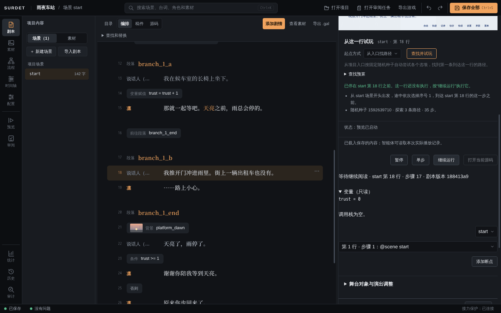
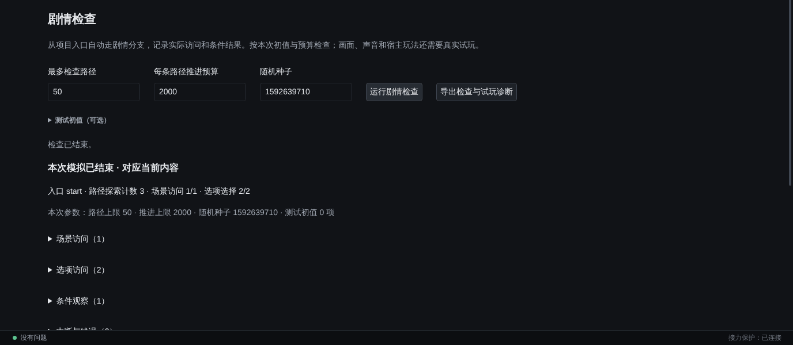
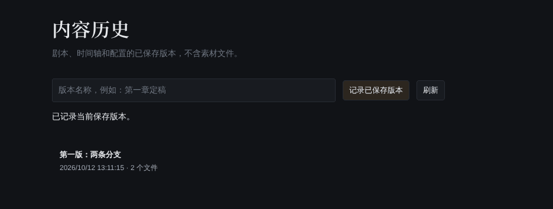

# 试玩与检查

## 预览

点左侧「预览」，画面在中间，右侧是状态和因果记录。

顶部的选项：

| 选项 | 说明 |
| --- | --- |
| 试玩内容 | 「当前编辑内容（含草稿）」包括没保存的修改；「来源项目（已保存）」只用磁盘上的版本 |
| 刷新试玩列表 | 外部 AI 助手交付了新的候选内容时，刷新这个列表 |
| 播放入口 | 「从场景开头」从当前选中的场景开始播放 |
| 跳过逐字显示 | 勾选后台词直接整句出现，方便快速检查 |
| 临时试看 | 临时换一个字号或动态效果看看排版，不改玩家设置 |
| 重新播放 | 按当前内容从头播放 |
| 检查当前排版 | 检查文字是否超出对话框或被裁掉 |
| 回到上次位置 | 按上次实际做过的选择重新走到那里；剧本改过导致对不上时会停下 |
| 启用调试（从入口重播） | 从入口重新播放，并可以暂停、单步、加断点 |

在画面上点击，或按空格、回车推进；选项可以点击，也可以用 ↑↓ 选择后回车。右侧「因果记录」列出每一步执行了什么、对应哪一行。

## 从标题开始完整试玩

「预览」从场景开始播放，不经过标题画面，场景结束后也不会回到标题。想检查标题画面、开始游戏和结局后回到标题的整个流程，用「配置 → 界面设计」里的「试玩草稿」：它会在 Editor 里打开一层「试玩草稿 · 独立测试进度」，从标题画面开始玩，用的是独立的测试进度，点「关闭试玩」退出。

## 从某一行开始试玩

在「剧本」里选中一行，点右上方的「从这一行试玩」。Editor 会从入口自动尝试各个选项，找到一条能走到这一行的路径，停在这一行之前。

右侧会显示：

- 停在哪里、路径怎么走（途中选了哪些选项）；
- 「暂停」「单步」「继续运行」「打开当前源码」；
- 当前变量值（只读）和调用栈；
- 可以给某一行「添加断点」。

找不到路径时（例如这一行永远走不到，或途中需要项目插件），会说明原因。

## 问题与定位

Editor 会一直检查剧本。状态栏左边显示「没有问题」，或错误和警告的数量。

- 点状态栏的问题数，或展开「剧本」右下角的「引用、问题与项目」，查看问题列表：文件、行号、错误码和修改建议。
- `F8` 跳到下一个问题，`Shift+F8` 回到上一个。
- 修改以后，旧的位置会失效，等重新检查完再定位。

行内标签的错误码见[行内标签](inline-text.md#写错了怎么办)，其他错误码见 [DSL 规范：错误码表](../dsl-spec.md#错误码表)。

## 流程图

点左侧「流程」，可以看到场景之间、段落之间怎么连接，选择会走向哪里。

- 「聚焦路径」只显示当前场景和直接相连的场景，「全局概览」显示全部。
- 「缩小」「放大」「查看全图」「回到当前」调整视图；右下角的缩略图可以点击跳转。
- 在节点上点右键，可以「编辑连接…」「重命名场景…」「删除场景…」。「编辑连接…」里能改选项的目标、删除连接、加新的连接或分支，也能新建场景。每次修改都会先列出将要改的源码，点「应用修改」才写入，可以撤销。
- 桌面版里「重命名场景…」目前不可用，见[写剧本：多个场景](writing.md#多个场景)里的已知问题。

## 剧情检查

点左侧「统计」，下方的「剧情检查」会从入口自动走遍各个分支，记录实际访问了哪些场景、选了哪些选项、条件结果如何，以及有没有运行错误。

- 「最多检查路径」「每条路径推进预算」控制检查范围；「随机种子」让带随机的剧情每次检查结果一致。
- 「测试初值（可选）」可以给变量换个初始值再检查。
- 结果里看「选项选择」是不是都走到了，「中断与错误」是不是 0。
- 「最近真实试玩」显示你最近一次在预览里实际走过的路径。

自动检查不能代替真实试玩：画面、声音和手感还要自己看。

「统计」上方还有字数、台词行数、选项数和预估通关时长。

## 文字一致性检查

点左侧「审计」，检查说话人称呼是否前后一致。在「配置 → 名词表」里登记作品里的专有名词后，也会检查名词的写法。

## 记录版本

点左侧「历史」，填一个版本名称，例如「第一章定稿」，点「记录已保存版本」。它会记下剧本、时间轴和配置当前已保存的内容（不含素材文件），以后可以在这里查看。

## 项目插件

有的作品会带项目插件（在 `game.config.json` 里声明的扩展代码）。预览页的「项目插件」一栏会列出声明了哪些插件、启用了几个。

- 插件是作品里受信任的代码，不是沙箱。只启用你信任的插件。
- 插件只在当前打开的项目目录里、经你确认的入口运行。
- 用了插件的项目，插件试玩只供本地查看，不能生成正式观察记录，也不能续接其他版本的进度。
- 导出游戏时，每个插件都要单独确认，见[导出 Windows 游戏](export-windows.md)。

详细规则见[项目插件合同](../project-plugins-contract.md)。
