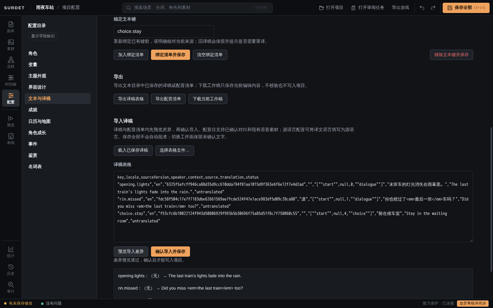
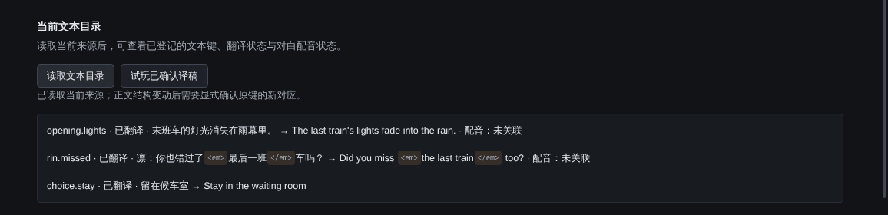

# 文本与译稿

作品可以有多种语言。做法是：给要翻译的台词、选项和人物名「登记一个固定的文本键」，导出成表格，填好译文后导入，确认无误再保存。Editor 不会自动翻译，也不会把译文猜着配给别的台词。

在「配置 → 文本与译稿」里操作。

## 1. 设定语言

页面顶部填「源语言」（作品原文的语言，例如 `zh-CN`）和「译文语言」（例如 `en`）。

## 2. 读取文本目录

点「读取文本目录」。Editor 会读取当前剧本，「当前文本来源」里列出所有可以登记的文字：每句对白、每个选项、人物显示名等，前面标着场景、段落和行号。

## 3. 绑定文本键

1. 在「当前文本来源」里选一句。
2. 「稳定文本键」填一个固定的名字，例如 `opening.lights`、`rin.missed`、`choice.stay`。键名以后不要随便改，译稿靠它对应。
3. 点「加入绑定清单」。重复以上步骤，把要翻译的文字都加进清单。
4. 核对清单，点「绑定清单并保存」。

保存后，「当前文本目录」会列出每个键、翻译状态（未翻译 / 已翻译）、原文和译文，对白还会显示配音状态。

## 4. 填写译文

- 点「载入已保存译稿」，「译稿表格」里会出现 CSV 格式的表格；也可以点「导出译稿表格」得到同样的表格文件。
- 表格每行一条：`key`（文本键）、`locale`（译文语言）、`sourceVersion`、`speaker`、`context`、`source`（原文）、`translation`（译文）、`status`。**只填 `translation` 这一列**，其他列保持不变。
- 可以直接在「译稿表格」里改，也可以用表格软件编辑后，点「选择表格文件…」载入。

译文里也可以用行内标签，规则和原文一样：例如选项的译文不能有停顿、变速、自动继续和抖动波浪。

## 5. 预览差异并导入

点「预览导入差异」。通过时显示「差异预览通过，确认后才能写入项目」，并逐条列出「原来 → 新译文」；有问题（例如标签写错、选项里用了停顿）时会说明原因，不能导入。

确认无误后点「确认导入并保存」。「保存全部」不会替你批准译稿，一定要点这个按钮。

## 6. 试玩译稿

点「试玩已确认译稿」，会从标题画面开始一次完整试玩。

## 在游戏里切换语言

玩家在「设置 → 阅读」的第 2 页切换「作品语言」。切换后剧情进度保持不变；没有译文的台词显示原文。

> 截图里人物名「凛」没有翻译，是因为教程只绑定了三句话。人物显示名也可以在「当前文本来源」里绑定。

## 改了剧本以后

- 改动了已绑定的台词，或者改动了它所在场景的结构（例如加了一行跳转），问题列表会出现 `TEXT_SOURCE_STALE` 警告：「译稿 … 的来源版本或对应关系变化，请明确重新绑定」。旧译稿会保留，不会自动配给别的台词。按提示重新选择来源、用原来的键再绑定一次即可。
- 没有译文、或译文已过期的台词，游戏里会显示原文。

## 配音清单

对白可以按文本键和语言关联已有的语音素材。用「导出配音清单」导出、填写后，同样通过「预览导入差异」「确认导入并保存」导入。缺少配音或配音过期时，游戏允许无声阅读，不会借用别的语言的录音。

## 译稿里的标签显示

文本目录和导入差异里，原文和译文中的标签会显示成独立的小标记，不再混在文字里，更容易看出两边的标签是否对应。

更多规则见 [AI 创作指南：文本目录与译稿 CSV](../AI-GUIDE.md#文本目录与译稿-csv) 和[当前限制：作品多语言](../known-limitations.md#作品多语言)。
