# 完整教程：雨夜车站

这篇教程从空白项目开始，做一个很短的作品《雨夜车站》：末班车开走了，主角在车站遇到凛，要选择留下来等天亮，还是冒雨去找出租车。两条分支最后汇合到同一个结局。

做完以后，你会用过这些功能：新建项目、角色与变量、导入素材、添加背景和人物、写对白、行内样式（着重号、注音、停顿、颜色、粗体）、分支、源码视图、问题提示、试玩、存档与文字记录、阅读设置、从某一行试玩、流程图、剧情检查、版本记录，以及导出 Windows 游戏。

> 截图来自 Linux 云端环境中的桌面版 Editor，路径显示为 Linux 路径。Windows 上的文件夹选择框和导出结果由技术负责人另行核对，见第 13 步。

## 0. 准备

- **Surdet Editor**：拿到 Editor 文件夹后，保留整个文件夹，双击其中的 `Surdet Editor.exe`。不需要另装 Node、启动服务或打开浏览器。
- **三张图片**：本指南附带的 [`tutorial-assets/`](tutorial-assets/) 里有 `station_night.png`、`platform_dawn.png` 和 `rin_coat_normal.png`。先把它们复制到你电脑上一个容易找到的文件夹。
- 建议在一个专门的练习文件夹里做教程，不要放进正式作品的目录。

## 1. 新建空白项目

打开 Editor，在启动页点「新建项目」。

1. 「项目名称」填 `雨夜车站`。这是作品标题，也是新文件夹的名称。
2. 「从哪里开始」选「空白项目」。
3. 「保存位置」点「选择位置…」，选一个父文件夹。项目会建在这个文件夹下的新子文件夹里；已有同名文件夹时不会覆盖。
4. 点「创建并打开」。

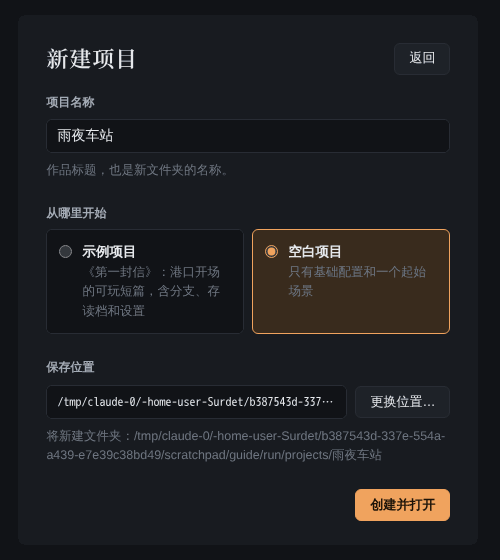

项目会在新窗口中打开。空白项目只有一个叫 `start` 的场景，里面有一句「在这里写下你的第一句故事。」。


界面分区见[开始使用](getting-started.md#界面分区)。

## 2. 添加角色和变量

**角色。** 点左侧的「配置」，在配置目录里选「角色」。「角色标识」填 `rin`，「显示名称」填 `凛`，点「添加角色」，再点「保存角色表」。状态栏会显示「角色表已保存」。

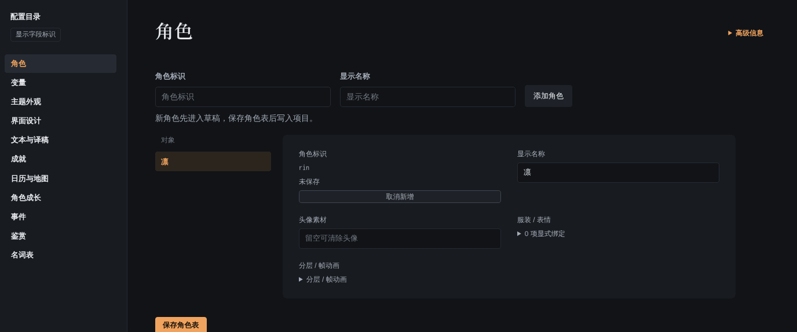

角色标识是给程序看的名字，建议只用英文字母、数字和下划线；显示名称是玩家看到的名字。立绘文件名会用到角色标识（第 3 步）。

**变量。** 在配置目录里选「变量」，点「＋ 新增变量」：

- 名称：`trust`
- 类型：数字
- 初始值：`0`
- 描述：`凛对主角的信任`

点「保存变量表」。

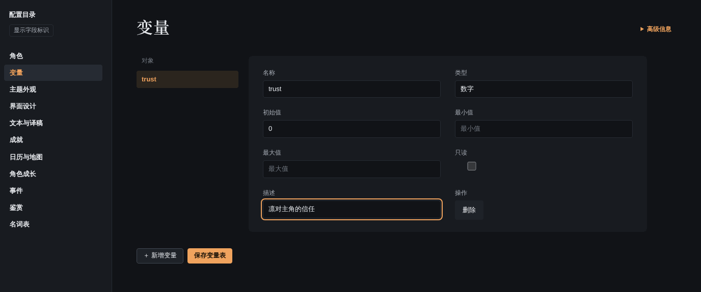

## 3. 导入素材

点左侧的「素材」，打开素材中心，点右上角的「导入素材」。

1. 点「选择文件，或拖到这里」，选中准备好的三张图片（可以一次多选）。
2. 在「文件设置」里给每个文件选「素材分类」：
   - `station_night.png`、`platform_dawn.png` 选「背景」；
   - `rin_coat_normal.png` 选「立绘」。
3. 「最终名称」保持原名即可。立绘的名字要按 `角色标识_服装_表情` 来起，这里是 `rin_coat_normal`：角色 `rin`、服装 `coat`、表情 `normal`。
4. 右侧「预览与问题」会显示选中文件的预览和目标位置。都没问题后点「准备导入」，再点「确认导入」。

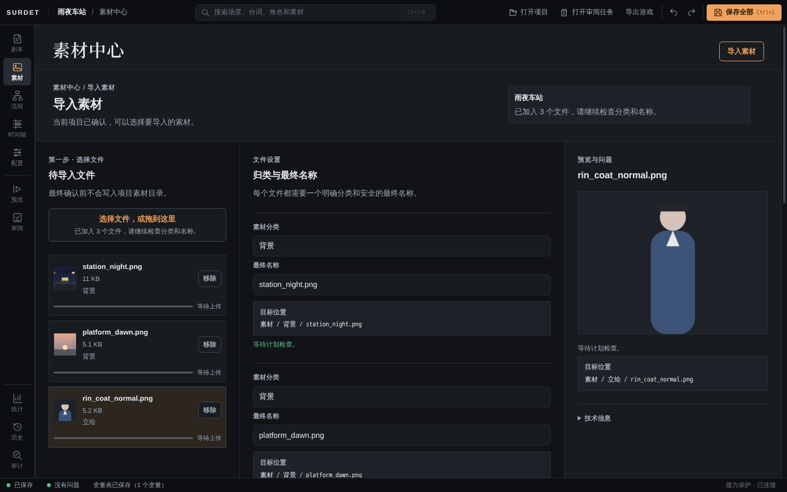

导入完成后会显示「已导入 3 个文件」。如果导入错了，可以点「撤销本次导入」。

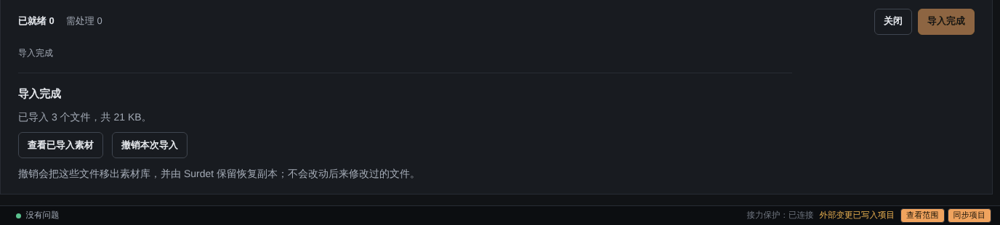

> **注意：** 导入完成后，右下角会提示「外部变更已写入项目」。请先点「同步项目」，再去改剧本。如果不同步就开始编辑，提示会变成「项目磁盘已变化，未覆盖你的草稿」，这时也可以点「保留草稿」继续，保存不受影响。

## 4. 写开场：背景、人物、第一句

点左侧的「剧本」，场景 `start` 会显示在「编排」视图里。每一行是一个剧情步骤。

**改第一句。** 点「在这里写下你的第一句故事。」这一行的文字，全选后改成：

```
末班车的灯光消失在雨幕里。
```

这一行没有说话人，就是旁白。

**加背景。** 点第 1 行「场景 start」，再点上方的「添加剧情」。「内容类型」选「背景」，「素材」选 `station_night`，点「插入到当前步骤之后」。

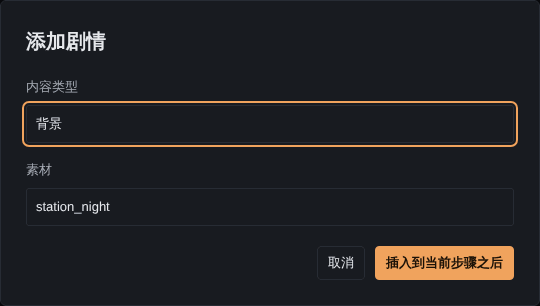

**加人物。** 点旁白那一行，再点「添加剧情」，类型选「人物」，「素材」选「凛 · coat」，「表情」选 `normal`，插入。右侧检查器里还可以改「出场位置」（左侧、中央、右侧）。


**加对白。** 点人物那一行，「添加剧情」，类型选「对白」，「说话人」填 `凛`，「对白」填：

```
你也错过了最后一班车吗？
```

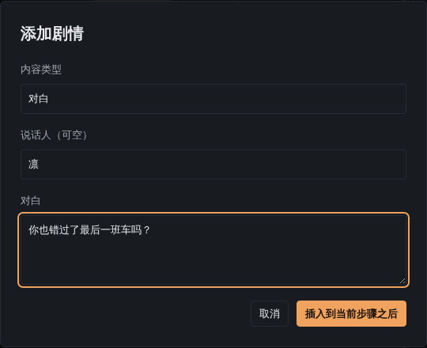

> 「添加剧情」总是把新步骤插在**当前选中的步骤之后**，插入后新步骤会成为当前步骤，所以可以连续往下加。

## 5. 行内样式

行内标签可以让一句话里的部分文字带样式或节奏。下面用三种方式各加一个。完整说明见[行内标签](inline-text.md)。

**用工具栏加着重号。** 在「你也错过了最后一班车吗？」里选中「最后一班」四个字，文字上方会出现工具栏。点「着重」（悬停提示为「着重号」）。这句话会变成：

```
你也错过了<em>最后一班</em>车吗？
```


**给词加注音。** 再加一句凛的对白：

```
这里是雨宿站。雨大的夜里，常有人在候车室等到天亮。
```

选中「雨宿」，在工具栏里点「注音」，在出现的小输入框里填 `yǔsù`，按回车。

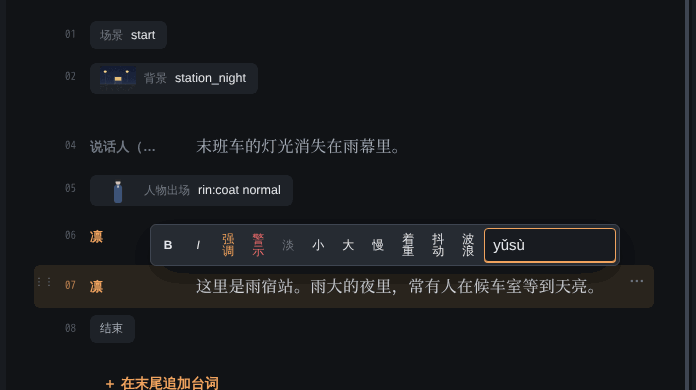

**用补全加停顿。** 再加一句：

```
你要等车，还是……
```

把光标放在「还是」前面，输入 `<w`，会弹出补全列表。用方向键选「`<w=毫秒>` 停顿，1–10000 毫秒」，按回车，Editor 会插入 `<w=500>` 并选中 `500`。直接输入 `600`，就是停顿 0.6 秒。


点到别处后，带样式的句子会显示成阅读效果：着重号、注音、「停0.6秒」标记。点回去又会显示源码。

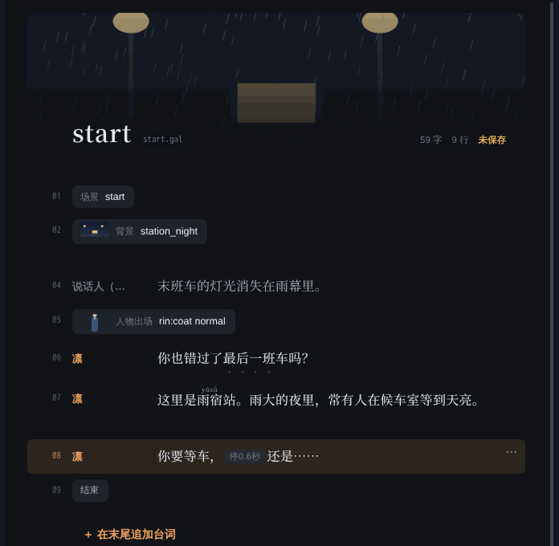

## 6. 加入分支

点「你要等车，还是……」这一行，「添加剧情」，类型选「分支」：

- 第一个选项：`留在候车室`
- 第二个选项：`冒雨去找出租车`

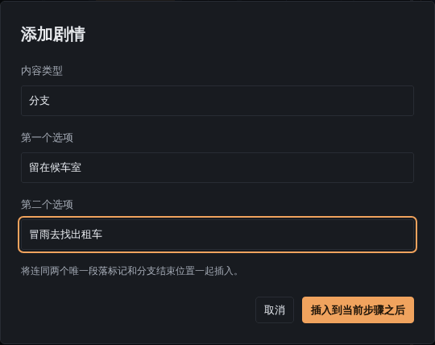

插入后，Editor 会一起生成两个段落（`branch_1_a`、`branch_1_b`）和分支结束位置（`branch_1_end`），每个段落里有一句占位文字。

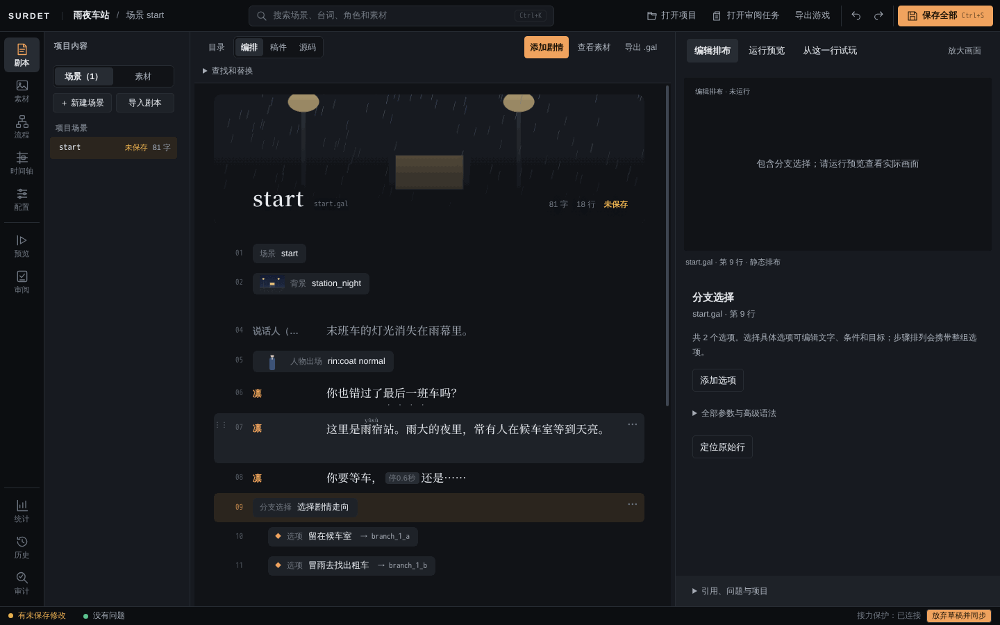

点某个选项行，右侧检查器里可以改「选项文字」「显示条件（可空）」和「目标段落」。

## 7. 写两条分支

**第一条：留下。** 把「在这里续写第一条分支。」改成：

```
我在候车室的长椅上坐下。
```

点这一行，「添加剧情」，类型选「变量」，「变量名」填 `trust`，「表达式」填 `trust + 1`，插入。这一步会把信任值加 1。

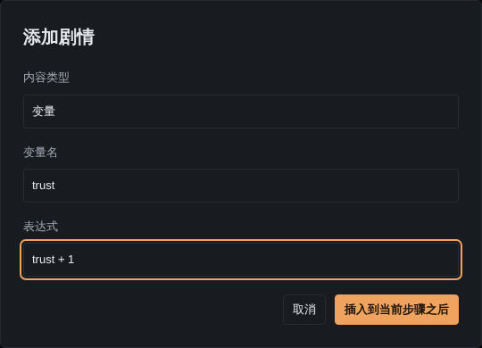

再在变量步骤后面加一句凛的对白：

```
那就一起等吧。天亮之前，雨总会停的。
```

选中「天亮」，在工具栏点「强调」（强调色）。

**第二条：离开。** 把「在这里续写第二条分支。」改成：

```
我推开门冲进雨里。街上一辆出租车也没有。
```

后面加一句凛的对白：`……路上小心。`

## 8. 用源码视图写结局，并修一个错误

结局要根据 `trust` 显示不同的话，用源码写更方便。点上方的「源码」切换到源码视图，这里显示的就是 `.gal` 文件的原文。

在 `@label branch_1_end` 这一行后面，输入下面几行。第二行故意漏掉 `</b>`，看看 Editor 怎么提示：

```
@bg platform_dawn
<b>天亮了，雨停了。
@if trust >= 1
凛：谢谢你陪我等到天亮。
@else
凛：原来你也回来了。
@endif
@clear rain_dawn
```

稍等一下，左下角会出现红色的错误数。点它，或者展开右下角的「引用、问题与项目」，可以看到「`<b>` 缺少 `</b>` [M002]」和修改建议。


> 你还会看到另一条「入口场景 'start' 不存在」。这是同一处标签错误的连带结果，补好标签后会一起消失。

在「天亮了，雨停了。」后面补上 `</b>`，错误消失，状态栏显示「没有问题」。

按 `Ctrl+S`（或点右上角「保存全部」）保存。状态栏显示「全部成功：已保存 1 项」，场景标题旁显示「已保存」。

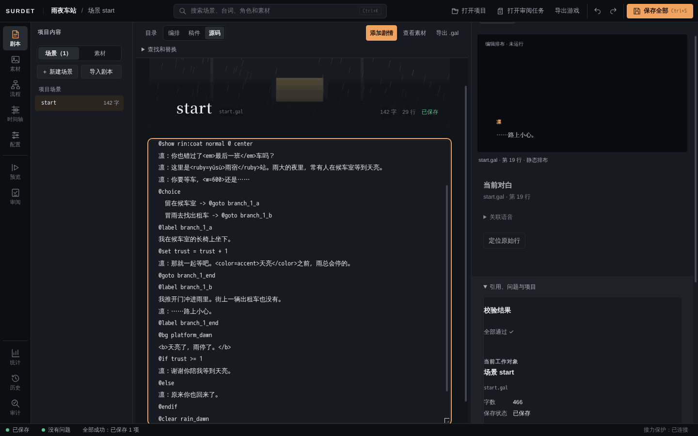

`@clear rain_dawn` 记录玩家达成了结局 `rain_dawn`，剧情检查会用到它。`@end` 结束场景；空白模板已把 `start` 设为结束后回到标题的场景。作品有多个场景时要注意的地方，见[写剧本](writing.md#多个场景)。

## 9. 试玩

点左侧的「预览」。「试玩内容」默认是「当前编辑内容（含草稿）」，没保存的修改也能试玩。点画面推进，或按空格、回车。


到选择处，点一个选项，或用 ↑↓ 选择、回车确认。


选「留在候车室」走到结局，凛会说「谢谢你陪我等到天亮。」（因为 `trust` 变成了 1）。可以点「重新播放」再走另一条分支对比。


## 10. 存档、文字记录和阅读设置

对话框下方是玩家工具栏：自动、快进、记录、快存、快读、设置、界面、菜单。

**文字记录。** 点「记录」（或按 L），可以看到读过的台词，着重号、注音和粗体都保留着。按 Esc 返回。


**设置。** 点「设置」。「阅读」页里有文本速度、自动停留、快进策略、文字大小、对话框不透明度和朗读未配音台词；「显示与输入」页里有减少动态效果。这些是玩家自己的偏好，不会写进作品。


**存档。** 点「菜单」，选「存档」，可以存到任意槽位；「快存」「快读」（F5、F9）用快速存档位。


更多说明见[存读档与阅读设置](player-features.md)。

## 11. 从某一行开始试玩

想直接检查第二条分支，不用每次从头点。回到「剧本」的「编排」视图，点「我推开门冲进雨里。…」这一行，再点右上方的「从这一行试玩」。

Editor 会从入口自动尝试各个选项，找到一条能走到这一行的路径（这里会选「冒雨去找出租车」），停在这一行之前。右侧显示停在哪里、走了哪条路径、当前变量值。点「继续运行」从这一行往下播放，也可以用「单步」一步一步执行。


## 12. 检查整部作品

**流程图。** 点左侧的「流程」，可以看到场景 `start` 的入口、两个选择后的分支，以及汇合的段落。


**剧情检查。** 点左侧的「统计」，在「剧情检查」里点「运行剧情检查」。Editor 会从入口自动走所有分支。这里应显示「选项选择 2/2」、「中断与错误（0）」。自动检查不能代替真实试玩，画面和声音还要自己看。


**记录版本。** 点左侧的「历史」，填一个版本名称，例如「第一版：两条分支」，点「记录已保存版本」。以后可以在这里查看剧本、时间轴和配置的已保存版本（不含素材文件）。


## 13. 导出 Windows 游戏

点右上角的「导出游戏」。

1. 先看「检查结果」。有错误时不能导出，按提示改好再来。
2. 「游戏标题」默认是作品标题。
3. 「Windows 版本」填三段或四段数字，例如 `1.0.0`。
4. 「程序图标」可以用项目素材里的 PNG 或 ICO；PNG 必须是 16 至 256 像素的正方形。不选就用默认图标。
5. 「导出位置」点「选择位置…」，选一个父文件夹，再填「新文件夹名称」。已有同名文件夹时不会覆盖。
6. 点「导出」。


导出只使用**磁盘上已保存的版本**。有没保存的修改时，对话框会提示「有尚未保存的修改」，点「保存全部并继续」即可。结果是一个免安装的 Windows x64 游戏文件夹，不生成安装器，也不签名。详细说明见[导出 Windows 游戏](export-windows.md)。

> **未在本环境验证：** 教程截图的环境是 Linux，不能生成 Windows 程序，点「导出」后显示「导出没有完成」。导出成功后的文件夹内容、运行效果，以及 Windows 系统文件夹选择框，由技术负责人在 Windows 上核对。

## 附：最终剧本

保存后，`content/scenario/start.gal` 的内容是：

```
@scene start
@bg station_night

末班车的灯光消失在雨幕里。
@show rin:coat normal @ center
凛：你也错过了<em>最后一班</em>车吗？
凛：这里是<ruby=yǔsù>雨宿</ruby>站。雨大的夜里，常有人在候车室等到天亮。
凛：你要等车，<w=600>还是……
@choice
  留在候车室 -> @goto branch_1_a
  冒雨去找出租车 -> @goto branch_1_b
@label branch_1_a
我在候车室的长椅上坐下。
@set trust = trust + 1
凛：那就一起等吧。<color=accent>天亮</color>之前，雨总会停的。
@goto branch_1_end
@label branch_1_b
我推开门冲进雨里。街上一辆出租车也没有。
凛：……路上小心。
@label branch_1_end
@bg platform_dawn
<b>天亮了，雨停了。</b>
@if trust >= 1
凛：谢谢你陪我等到天亮。
@else
凛：原来你也回来了。
@endif
@clear rain_dawn
@end
```

想继续练习，可以试试：

- 在[文本与译稿](translation.md)里给几句台词加英文译稿，再切换作品语言试玩；
- 用「添加剧情」加一个「转场」或「画面滤镜」，见[素材与演出](assets-and-staging.md)；
- 再做一个场景，从结局跳过去，见[写剧本：多个场景](writing.md#多个场景)。
