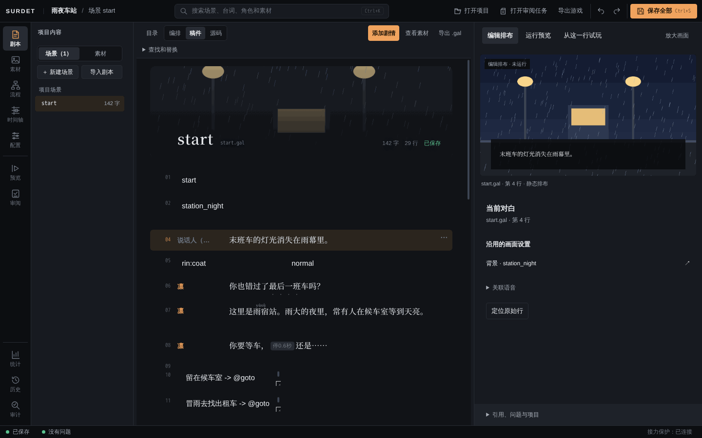
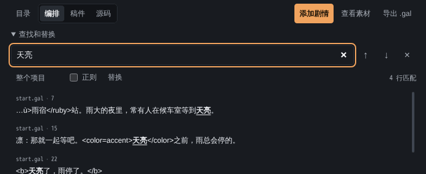
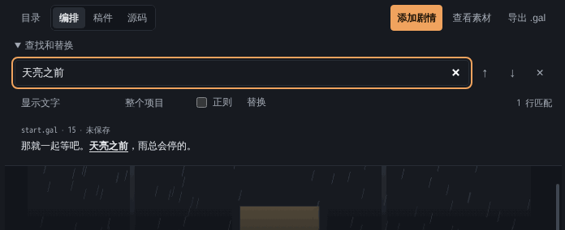
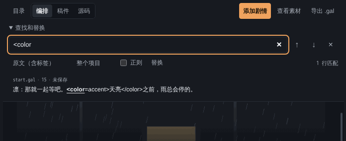
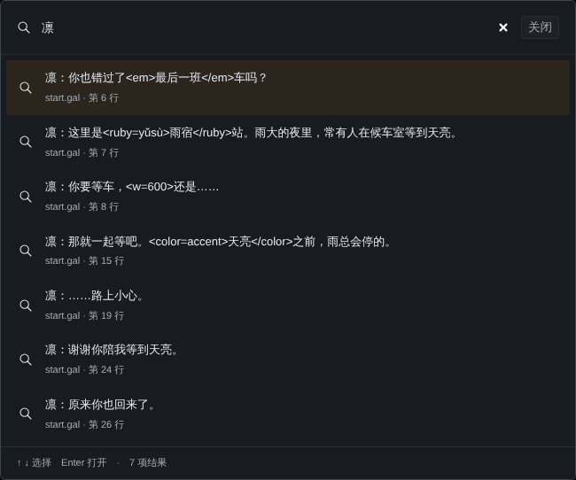

# 写剧本

剧本保存在 `content/scenario/` 下的 `.gal` 文件里，一个文件是一个场景，场景名就是文件名（`start.gal` 就是场景 `start`）。精确语法见 [DSL 规范](../dsl-spec.md)，这里讲在 Editor 里怎么写。

## 三种视图

点左侧「剧本」，再在中间顶部切换：

- **编排**：一行一个剧情步骤，用表单添加和修改，适合大多数编辑。右侧检查器显示当前步骤的属性。
- **稿件**：按阅读效果显示台词，方便通读和校对。
- **源码**：直接显示和编辑 `.gal` 原文，适合一次写很多行、写条件判断，或粘贴已有的稿子。

三种视图改的是同一份剧本，可以随时切换。「目录」按钮用来展开或收起左边的场景列表；「导出 .gal」下载当前场景文件。



## 添加剧情步骤

在「编排」视图里先点一个步骤，再点「添加剧情」，新步骤会插在它后面，插入后新步骤成为当前步骤。也可以点列表底部的「＋ 在末尾追加台词」。

| 内容类型 | 用来做什么 |
| --- | --- |
| 对白 | 一句台词。「说话人」留空就是旁白 |
| 背景 | 切换背景图 |
| 人物 | 让人物出场，选立绘和表情；出场位置在检查器里改 |
| 转场 | 把修改前的画面过渡到新画面，放在背景、人物的修改之后，见[素材与演出](assets-and-staging.md#转场与画面滤镜) |
| 画面滤镜 | 模糊、灰度、怀旧、暗角，或清除滤镜 |
| 语音、音乐、音效 | 播放项目里的声音素材 |
| 等待 | 停顿若干毫秒 |
| 分支 | 插入一组选项，连同两个段落标记和分支结束位置 |
| 时间轴 | 播放「时间轴」里做好的演出片段 |
| 变量 | 给变量赋值，例如 `trust = trust + 1` |
| 原始指令 | 直接写一行指令，用于表单还没覆盖的写法 |

某一类素材还没导入时，对应的步骤会提示「该类素材尚未导入，可以先去素材中心处理」。

## 对白与旁白

源码里一句台词写成 `说话人：内容`，中文冒号和英文冒号都可以；没有说话人的一行就是旁白：

```
凛：你也错过了最后一班车吗？
末班车的灯光消失在雨幕里。
```

- 台词里可以用 `{变量名}` 显示变量的值，例如 `我是{heroName}。`。
- 一句话里的粗体、颜色、注音、停顿等，见[行内标签](inline-text.md)。
- 以 `//` 开头的行是注释，玩家看不到。

## 分支

用「添加剧情」→「分支」插入选项最省事：Editor 会同时生成选项、每个选项要去的段落，以及分支结束的位置。

点某个选项，右侧检查器里可以改：

- **选项文字**：玩家看到的文字。
- **显示条件（可空）**：满足条件才显示这个选项，例如 `trust >= 1`。
- **目标段落**：选了以后跳到哪个段落。

点「分支选择」这一行，检查器里有「添加选项」。

在源码里，选项写在 `@choice` 下面，每个选项前面必须缩进：

```
@choice
  留在候车室 -> @goto branch_1_a
  冒雨去找出租车 -> @goto branch_1_b
```

两点要注意：

- `@choice` 后面所有缩进的行都会被当成选项。选项后面的正文不要缩进。
- 如果所有选项都带显示条件，玩家可能一个都看不到，剧情会直接跳过这次选择。至少保留一个没有条件的选项。

## 变量与条件

先在「配置 → 变量」里声明变量：名称、类型（数字、文本、布尔值、开关、文本列表、数字列表、对象）、初始值，数字还可以填最小值和最大值。剧本里用到的变量都要先在这里声明。

改变量：用「添加剧情」→「变量」，或在源码里写 `@set trust = trust + 1`。

按条件显示不同内容，在源码里用 `@if`、`@elif`、`@else`、`@endif`，必须成对：

```
@if trust >= 1
凛：谢谢你陪我等到天亮。
@else
凛：原来你也回来了。
@endif
```

条件里可以用 `==`、`!=`、`<`、`>=`、`&&`、`||` 等，详见 [DSL 规范：表达式语言](../dsl-spec.md#表达式语言)。

## 多个场景

作品可以拆成多个场景。场景之间用 `@jump 场景名` 跳转；同一场景里的段落之间用 `@goto 段落名`。

**新建场景。** 左侧场景列表上方有「＋ 新建场景」按钮。点它会打开「新建场景」对话框：填场景标识（就是文件名，不含 `.gal`，不能有空格或点号），在「模板」里选一种开头，点「新建」。新场景先进入草稿，「保存全部」后写入磁盘。

场景行上的「重命名场景」「移动场景」，以及流程图节点右键菜单里的「重命名场景…」，也都在 Editor 内的对话框里填写。重命名会一并改写剧情里的跳转；移动只改文件所在的章节目录。输入不合规时对话框不会关闭，会显示原因，已填的内容保留。

> **旧版本：** 这些对话框在 #42 合入主线（`4576cf2`）后才有；日常使用的 Editor 要重新打包后才包含它。之前打包的桌面版 Editor 里，这几个按钮点了没有反应，状态栏会显示「prompt() is not supported.」。用这种版本时，可以在流程图里新建场景：
>
> 1. 点左侧「流程」，在要接到新场景的段落上点右键，选「编辑连接…」。例如要从结局接到尾声，就在结局所在的段落上操作。
> 2. 在「新建场景」一栏填场景名（文件名，不含 `.gal`，不能有空格和点号），点旁边的「预览」。
> 3. 对话框会列出将要修改的源码：在这个段落末尾加一行 `@jump 新场景名`（段落以 `@end` 结尾时加在 `@end` 之前），并新建一个场景文件。确认无误后点「应用修改」，再保存。
>
> 新场景出现在场景列表里，可以照常编辑。

**最后一个场景要列为结束场景。** 玩家走到 `@end` 时，只有列在 `game.config.json` 里 `player.endScenes` 的场景结束后才会回到标题画面；不在列表里的场景结束后，画面会停在最后一句。空白模板里只列了 `start`。

在「配置 → 结束场景」里修改：在「要添加的结束场景」里选场景，点「添加」；不需要的点旁边的「移除」。改完点「保存结束场景」，或者「保存全部」。「取消设置」会把这一项从配置里删掉，效果和空列表相同。这里只决定读完后是否回到标题，不算通关，通关仍由剧本里的 `@clear` 记录。场景改名时，结束场景列表会跟着改。

> **旧版本：** 这个入口也是 #42 合入后才有。之前打包的 Editor 里没有，可以先关闭项目窗口，用文本编辑器打开项目文件夹里的 `game.config.json`，把场景名加进去，保存后再打开项目：
>
> ```json
> "player": { "endScenes": ["epilogue"] }
> ```

> 实测：新建 `epilogue` 并从 `start` 跳过去后，`endScenes` 只有 `start` 时，从标题开始完整试玩到 `epilogue` 结束，画面停在最后一句；改成 `["epilogue"]` 后会回到标题画面。完整试玩方法见[试玩与检查](preview-and-checks.md#从标题开始完整试玩)。

`@end` 只是结束场景，不等于玩家通关。要在剧情检查里记录结局，在 `@end` 前写 `@clear 结局名`。

## 查找与替换

在「剧本」中间顶部展开「查找和替换」，输入要找的文字。结果按场景和行号列出，点一条就跳到对应行；回车、Shift+回车在结果之间切换。

- 默认在「整个项目」里找，勾选「正则」可以用正则表达式。
- 每行先按原文找；原文里找不到时，对白和选项还会按玩家看到的文字找，所以被样式标签隔开的词组也能找到。
- 点「替换」展开替换框，「替换整个项目」会先列出所有改动，确认后才写入，可以撤销。跨过标签或在标签内部的匹配会跳过，并告诉你跳过了几处。



> **待合入（PR #36、#38）：** 查找方式会分成「显示文字」和「原文（含标签）」两种。按显示文字查找时，结果显示去掉标签后的文字；按原文查找时，搜的是剧本里写的原文，包括标签、指令和说话人。
>
> 
>
> 

## 搜索整个项目（Ctrl+K）

按 `Ctrl+K` 或点顶栏的搜索框，可以搜场景、台词、角色和素材，回车打开选中的结果。输入 `>` 开头可以执行命令，例如「保存全部」「查看问题列表」「同步项目」「剧本视图：源码」。



## 导入已有稿件

已经有纯文本或表格稿件时，可以点场景列表上方的「导入剧本」：先映射列和角色、检查逐行问题，再创建新场景。导入不会覆盖原有场景，也不会执行导入文字中的指令。

> 本指南没有在 Linux 环境中实测「导入剧本」流程。
